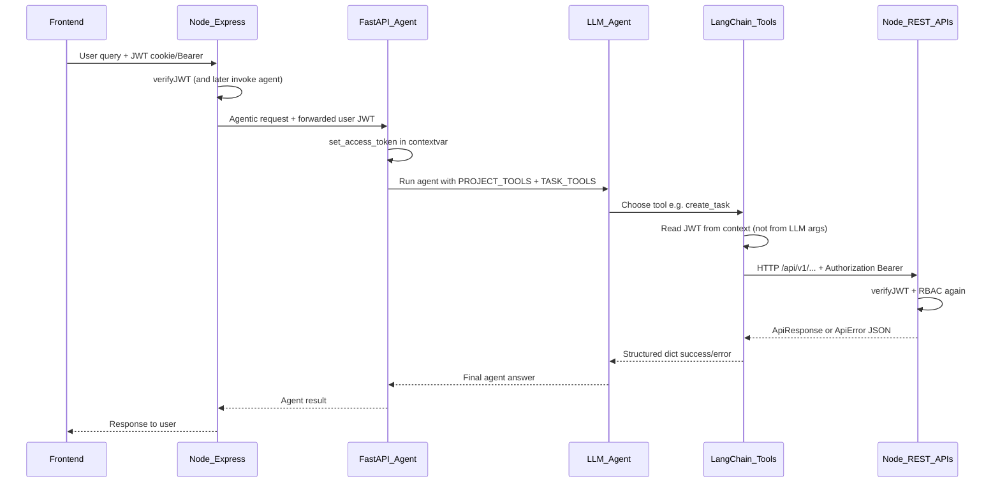

# Agent Project/Task Tools Plan

> **Status:** Implemented (Tools pass complete)  
> **Package:** `user_agent`  
> **Related Node architecture:** [`project_management/backend_architecture.md`](../project_management/backend_architecture.md)  
> **Node routes:** [`project.routes.js`](../project_management/src/routes/project.routes.js), [`task.routes.js`](../project_management/src/routes/task.routes.js)

This document is the detailed design for LangChain tools that let an agent create, read, update, and delete **projects** and **tasks** by calling the existing Node.js REST API. It is the source of truth for the tools implementation pass.

---

## 1. Goals

1. Provide two tool categories under `src/user_agent/agents/tools/`:
   - **Project tools** → `project.py`
   - **Task tools** → `task.py`
2. Each tool maps 1:1 to an existing Node endpoint under `/api/v1/projects` or `/api/v1/tasks`.
3. Support natural-language flows such as:
   - “Create a project called Marketing”
   - “List my projects”
   - “Add a todo task to project X”
   - “Update / delete that task”
4. Keep authentication owned by the **Node.js** server. Tools never invent credentials; they only forward a user JWT that Node already verified and passed to FastAPI.

---

## 2. Confirmed product / architecture decisions

| Decision | Choice |
|---|---|
| User entry | Frontend sends the user query to **Node.js** |
| Auth authority | **Node.js** (`verifyJWT` + RBAC on project/task routes) |
| Agent runtime | Node **internally** calls **FastAPI** (`user_agent`) for agentic work |
| Tool → API | Tools call Node REST with `Authorization: Bearer <user JWT>` |
| Token visibility | JWT lives in **run context** (contextvar / config). **Not** an LLM tool argument |
| Tool surface (v1) | **list + get + create + update + delete** for projects and tasks |
| Attachments | **Out of scope** — Node attachment upload is unimplemented for agents; tools send **JSON only** |
| Members / roles / subtasks / chat / notes | **Out of scope for v1** |
| This pass | **Tools only** — no FastAPI agent route / LLM graph / Node proxy controller yet |

---

## 3. End-to-end call flow



### Why Node calls FastAPI (not the reverse for auth)

- Frontend already authenticates against Node.
- Node remains the single auth/RBAC gateway users know.
- FastAPI is an internal agent worker. It receives the verified user’s access token for the duration of one agent run so tools can act **as that user** on Node APIs.

### Expected Node → FastAPI contract (for a later implementation)

When Node invokes FastAPI for agentic work it **must** forward the user’s access token:

- **Preferred:** HTTP header `Authorization: Bearer <accessToken>`
- **Alternative:** body/field `accessToken` (less preferred)

FastAPI (later) will:

1. Extract the token.
2. Call something like `set_access_token(token)` before the agent runs.
3. Clear/reset context after the run.

Tools assume this contract. If the token is missing, tools return a structured auth error (do not crash the process silently).

---

## 4. Repository layout (implemented)

Tools live inside the installable `user_agent` package (`src/` layout) so
`import user_agent.agents.tools` works after `uv sync` / `pip install -e .`.

```
user_agent/
├── AGENT_TOOLS_PLAN.md
├── pyproject.toml
├── tests/
│   └── test_agent_tools.py
└── src/
    └── user_agent/
        ├── __init__.py              # re-exports ALL_TOOLS / token helpers
        ├── main.py                  # uvicorn CLI entry
        ├── api/
        │   ├── app.py               # FastAPI app
        │   ├── schemas.py
        │   └── routes/agent.py      # GET /health, POST /agent/run
        └── agents/
            ├── __init__.py
            ├── runner.py            # Groq create_agent + run_agent
            └── tools/
                ├── __init__.py      # PROJECT_TOOLS, TASK_TOOLS, ALL_TOOLS
                ├── _api_client.py   # shared HTTP + JWT context
                ├── project.py       # project tools
                └── task.py          # task tools
```


**Import path (canonical):**

```python
from user_agent.agents.tools import ALL_TOOLS, set_access_token
# or
from user_agent import ALL_TOOLS, set_access_token
```

Do **not** use a top-level `agents/` package at the repo root — that layout was
fragile (only worked when cwd was on `PYTHONPATH`).

---

## 5. Shared HTTP client design

**File:** `src/user_agent/agents/tools/_api_client.py`

### Responsibilities

1. Resolve base URL from env.
2. Hold / read per-request JWT via `contextvars`.
3. Perform HTTP calls to Node with JSON bodies and Bearer auth.
4. Normalize Node success/error payloads into tool-friendly dicts.
5. Never log the raw JWT.

### Configuration

| Env var | Purpose | Default |
|---|---|---|
| `NODE_API_BASE_URL` | Prefix for Node API | `http://localhost:3000/api/v1` |

### Suggested API surface

```text
set_access_token(token: str) -> None
get_access_token() -> str | None
clear_access_token() -> None

request(method, path, *, json=None, params=None) -> dict
  # Adds Authorization: Bearer <token>
  # Returns { "success", "statusCode", "message", "data", "errors"? }
```

### Response normalization

Node success (`ApiResponse`):

```json
{
  "statusCode": 200,
  "data": {},
  "message": "...",
  "success": true
}
```

Node error (`errorHandler` / rate limit):

```json
{
  "statusCode": 401,
  "message": "...",
  "errors": [],
  "success": false
}
```

Tools should return a compact dict the LLM can reason over, for example:

```json
{
  "ok": true,
  "statusCode": 201,
  "message": "Project created Successfully",
  "data": { "_id": "...", "name": "Marketing" }
}
```

or on failure:

```json
{
  "ok": false,
  "statusCode": 403,
  "message": "You do not have permission to perform this action",
  "errors": []
}
```

Prefer returning structured errors for `401` / `403` / `404` / `422` / `429` so the agent can recover (e.g. `list_projects` then retry) instead of only raising opaque exceptions.

### HTTP library

- Use **`httpx`** (add to `pyproject.toml`).
- Prefer **sync** client + sync `@tool` functions for v1 (simpler LangChain binding). Switch to async later if the agent loop is async.

---

## 6. Tool design conventions

1. **Import:** `from langchain_core.tools import tool`  
   (Do **not** use `from langchain_core import tool` — that is invalid.)
2. **Typed parameters** with Python type hints.
3. **Docstrings** are LLM-facing: when to call the tool, required IDs, allowed enums.
4. **JWT is never** a tool parameter.
5. Return **JSON-serializable dicts**, not raw `httpx.Response` objects.
6. Export registries for later agent binding:
   - `PROJECT_TOOLS = [list_projects, get_project, create_project, update_project, delete_project]`
   - `TASK_TOOLS = [list_tasks, get_task, create_task, update_task, delete_task]`
7. Optional: `ALL_TOOLS = PROJECT_TOOLS + TASK_TOOLS`.

### ID resolution pattern (why list/get exist)

Users speak in names (“Marketing project”, “login bug”). Node APIs require Mongo ObjectIds.

Typical agent loop:

1. `list_projects` → find project by name → get `_id`
2. `list_tasks(project_id)` → find task → get `_id`
3. `update_task` / `delete_task` with resolved IDs

Tools do **not** need fuzzy matching helpers in v1; the LLM can match on returned names.

---

## 7. Project tools (detailed)

**File:** `src/user_agent/agents/tools/project.py`  
**Node router:** `/api/v1/projects` (all routes require JWT)

### 7.1 `list_projects`

| | |
|---|---|
| **Node** | `GET /api/v1/projects` |
| **AuthZ** | Any authenticated user (returns memberships for that user) |
| **Args** | None |
| **Use when** | User asks what projects they have, or agent needs to resolve a project name → id |

**Typical `data` shape (from Node aggregation):** array of `{ project: { _id, name, description, members, createdAt, createdBy }, role }`.

### 7.2 `get_project`

| | |
|---|---|
| **Node** | `GET /api/v1/projects/:projectId` |
| **AuthZ** | Project member (any role) |
| **Args** | `project_id: str` |
| **Use when** | Need full project document by id |

### 7.3 `create_project`

| | |
|---|---|
| **Node** | `POST /api/v1/projects` |
| **AuthZ** | Any authenticated user |
| **Body** | `{ "name": string, "description"?: string }` |
| **Args** | `name: str`, `description: str | None = None` |
| **Side effects on Node** | Creates `Project`, `ProjectMember` (creator = `admin`), default `Conversation` chat group |

**Validation:** `name` required (Node `createProjectValidator`).

### 7.4 `update_project`

| | |
|---|---|
| **Node** | `PUT /api/v1/projects/:projectId` |
| **AuthZ** | `admin` only |
| **Body** | `{ "name": string, "description"?: string }` |
| **Args** | `project_id: str`, `name: str`, `description: str | None = None` |
| **Note** | Node reuses create validator (`name` required). Prefer sending the intended full name/description. |

### 7.5 `delete_project`

| | |
|---|---|
| **Node** | `DELETE /api/v1/projects/:projectId` |
| **AuthZ** | `admin` only |
| **Args** | `project_id: str` |
| **Caveat** | Node deletes project + conversations/messages; members/tasks/subtasks may remain orphaned (existing backend behavior). Tools should not “fix” that in v1. |

### Project tools explicitly **not** in v1

| Endpoint | Reason |
|---|---|
| `GET/POST /projects/:id/members` | Members/roles deferred |
| `PUT/DELETE /projects/:id/members/:userId` | Members/roles deferred |

---

## 8. Task tools (detailed)

**File:** `src/user_agent/agents/tools/task.py`  
**Node router:** `/api/v1/tasks` (all routes require JWT + project permission)

### Status enum (must match Node)

From `project_management/src/utils/constants.js`:

- `todo`
- `in_progress`
- `done`

Invalid status → Node `422`.

### 8.1 `list_tasks`

| | |
|---|---|
| **Node** | `GET /api/v1/tasks/:projectId` |
| **AuthZ** | Any project member |
| **Args** | `project_id: str` |
| **Use when** | List tasks in a project; resolve task title → id |

### 8.2 `get_task`

| | |
|---|---|
| **Node** | `GET /api/v1/tasks/:projectId/t/:taskId` |
| **AuthZ** | Any project member |
| **Args** | `project_id: str`, `task_id: str` |
| **Note** | Node returns task with populated assignee + nested subtasks via aggregation. Tools return that `data` as-is (read-only). |

### 8.3 `create_task`

| | |
|---|---|
| **Node** | `POST /api/v1/tasks/:projectId` |
| **AuthZ** | `admin` or `project_admin` |
| **Content-Type** | `application/json` only (**no** multipart / attachments) |
| **Body** | `{ "title": string, "description"?: string, "assignedTo"?: string, "status"?: "todo"|"in_progress"|"done" }` |
| **Args** | `project_id: str`, `title: str`, `description: str | None = None`, `assigned_to: str | None = None`, `status: str | None = None` |

**Important:** Node route still mounts `upload.array("attachments")`, but the controller does not persist attachments. Agent tools must **not** expose file upload parameters.

### 8.4 `update_task`

| | |
|---|---|
| **Node** | `PUT /api/v1/tasks/:projectId/t/:taskId` |
| **AuthZ** | `admin` or `project_admin` |
| **Content-Type** | `application/json` only |
| **Body** | Partial fields: `title?`, `description?`, `status?`, `assignedTo?` |
| **Args** | `project_id: str`, `task_id: str`, optional `title`, `description`, `assigned_to`, `status` |

Only send fields the user/agent intends to change (omit `None` from JSON body).

### 8.5 `delete_task`

| | |
|---|---|
| **Node** | `DELETE /api/v1/tasks/:projectId/t/:taskId` |
| **AuthZ** | `admin` or `project_admin` |
| **Args** | `project_id: str`, `task_id: str` |
| **Side effects** | Node also deletes related subtasks |

### Task tools explicitly **not** in v1

| Endpoint | Reason |
|---|---|
| Subtask create/update/delete | Deferred |
| Attachment upload fields | Unimplemented / out of scope |

---

## 9. RBAC cheat sheet for tool authors / agent prompts

| Action | Required project role |
|---|---|
| List/get projects (membership-scoped) | Authenticated / member |
| Create project | Authenticated |
| Update/delete project | `admin` |
| List/get tasks | any member (`admin`, `project_admin`, `member`) |
| Create/update/delete task | `admin` or `project_admin` |

If Node returns `403`, the tool result should surface the permission message so the agent can explain the failure to the user instead of retrying blindly.

---

## 10. Example tool signatures (illustrative)

These are design sketches, not final code.

```python
# project.py
@tool
def list_projects() -> dict:
    """List projects the current user belongs to. Use to resolve project names to IDs."""

@tool
def get_project(project_id: str) -> dict:
    """Fetch a single project by MongoDB project_id."""

@tool
def create_project(name: str, description: str | None = None) -> dict:
    """Create a new project. Caller becomes admin. Name must be unique."""

@tool
def update_project(project_id: str, name: str, description: str | None = None) -> dict:
    """Update project name/description. Requires admin role."""

@tool
def delete_project(project_id: str) -> dict:
    """Delete a project by ID. Requires admin role. Destructive."""


# task.py
@tool
def list_tasks(project_id: str) -> dict:
    """List all tasks in a project. Use to resolve task titles to IDs."""

@tool
def get_task(project_id: str, task_id: str) -> dict:
    """Fetch one task (with subtasks metadata) by project_id and task_id."""

@tool
def create_task(
    project_id: str,
    title: str,
    description: str | None = None,
    assigned_to: str | None = None,
    status: str | None = None,
) -> dict:
    """Create a task. status must be todo|in_progress|done. No file attachments."""

@tool
def update_task(
    project_id: str,
    task_id: str,
    title: str | None = None,
    description: str | None = None,
    assigned_to: str | None = None,
    status: str | None = None,
) -> dict:
    """Update task fields. Omit unchanged fields. No file attachments."""

@tool
def delete_task(project_id: str, task_id: str) -> dict:
    """Delete a task and its subtasks. Requires admin or project_admin."""
```

---

## 11. Dependencies

Update `user_agent/pyproject.toml`:

| Package | Why |
|---|---|
| `httpx` | HTTP client for Node API calls |
| `langchain` / `langchain-core` | `@tool` decorator (`from langchain_core.tools import tool`) |
| `fastapi[standard]` | Already present; used later for agent HTTP entry (not this pass) |

---

## 12. Explicit non-goals (this implementation pass)

1. FastAPI agent route / LangGraph or agent executor wiring
2. Node controller that proxies user queries to FastAPI
3. Frontend chat UI for the agent
4. Attachment / file upload tools
5. Member invite / role change tools
6. Subtask tools
7. Chat / notes tools
8. Automated test suite (unless requested later)
9. Changing Node route contracts or RBAC rules

---

## 13. Implementation order

1. **Shared client** — `_api_client.py` with contextvar JWT + `request()` helper + env base URL  
2. **Project tools** — five tools in `project.py` + `PROJECT_TOOLS` export  
3. **Task tools** — five tools in `task.py` + `TASK_TOOLS` export (`create_task.py` stub removed)  
4. **Deps** — add `httpx` (and langchain-core if needed) to `pyproject.toml`  
5. **Docs in code** — module docstrings pointing at this plan + Node JWT forward contract  
6. **Manual smoke** — with a real JWT against local Node (`list_projects`, `create_project`, `create_task`, etc.)

---

## 14. Agent runtime status & next work

### Done — FastAPI Groq agent

- `POST /agent/run` — body `{ "query": "..." }` + header `Authorization: Bearer <userJWT>`
- `GET /health` — liveness
- Runner: `src/user_agent/agents/runner.py` (`ChatGroq` + `create_agent` + `ALL_TOOLS`)
- JWT context: `set_access_token` / `clear_access_token` around each run
- Env: `GROQ_API_KEY`, `GROQ_MODEL` (default `llama-3.3-70b-versatile`), `NODE_API_BASE_URL`
- Start: `uv run uvicorn user_agent.api.app:app --reload --port 8000` (or `uv run user-agent`)

### Done — End-to-End Stack

- `POST /agent/run` (FastAPI) — body `{ "query": "..." }` + header `Authorization: Bearer <userJWT>`
- Runner: `src/user_agent/agents/runner.py` (`ChatGroq` + `create_agent` + `ALL_TOOLS`)
- JWT context: `set_access_token` / `clear_access_token` around each run
- `POST /api/v1/agent/run` (Node.js) — proxy with `verifyJWT` forwarding user token to FastAPI
- Frontend UI (`project-management-frontend`) — Camp Agent interface at `/agent` with stationery design

### Optional follow-on work

1. Optional follow-on tools: members, subtasks (still no attachments until Node persists them).
2. Update this document when architecture changes are approved.

---

## 15. Checklist for implementers / AI agents

- [x] Read this plan and [`project_management/backend_architecture.md`](../project_management/backend_architecture.md)
- [x] Do not invent endpoints that are not in Node routes
- [x] Do not add attachment parameters
- [x] Do not put JWT in tool args
- [x] Use exact status strings: `todo`, `in_progress`, `done`
- [x] Map snake_case tool args (`assigned_to`, `project_id`) to Node JSON (`assignedTo`, path params)
- [x] Preserve Node API contracts; do not refactor Node for this pass
- [x] Update this markdown if the approved tool surface changes

---

## 16. Summary

| Category | Tools / Features |
|---|---|
| Project | `list_projects`, `get_project`, `create_project`, `update_project`, `delete_project` |
| Task | `list_tasks`, `get_task`, `create_task`, `update_task`, `delete_task` |
| Auth | JWT in FastAPI context → tools relay Bearer to Node |
| Transport | `httpx` → `NODE_API_BASE_URL` (`/api/v1`) |
| Agent | Groq + LangChain `create_agent` via `POST /agent/run` |
| Node Proxy | Express route `POST /api/v1/agent/run` with `verifyJWT` |
| Frontend | Next.js Camp Agent page at `/agent` with papercraft UI |
| Out of scope (still) | Attachments, members, subtasks |

**Confirmation:** Full stack integration complete: LangChain tools, FastAPI Groq agent, Node Express proxy, and Next.js frontend UI.
