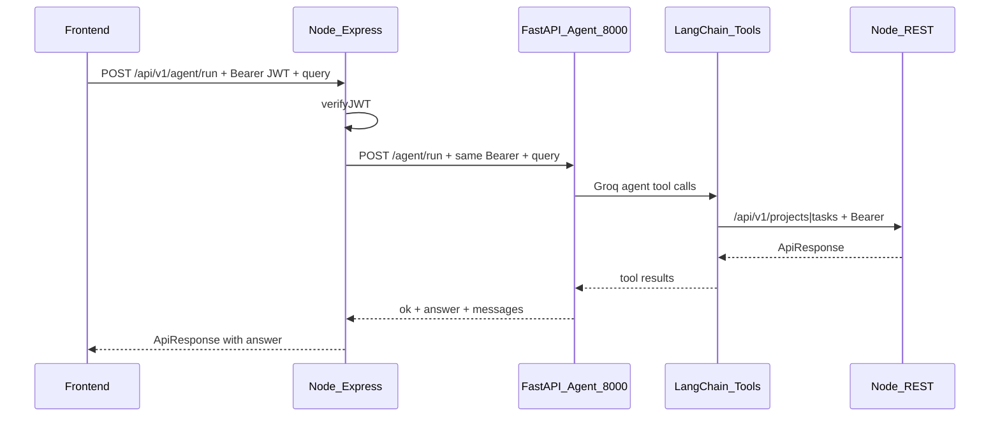

# Next Steps for Junior Developers — Node Agent Proxy + Frontend

> **Audience:** Junior developers continuing Project Camp after the Python agent tools + FastAPI Groq runtime are done.  
> **Do this in order:** **Phase 1 (Node proxy)** first, then **Phase 2 (Frontend)**.  
> **Do not** redesign auth, tools, or the FastAPI contract unless a lead approves.

---

## 0. Current state (already done — do not rebuild)

| Layer | Status | Location |
|---|---|---|
| Node REST APIs (projects/tasks/auth) | Done | `project_management/` |
| LangChain tools (call Node APIs) | Done | `user_agent/src/user_agent/agents/tools/` |
| FastAPI Groq agent | Done | `user_agent/src/user_agent/api/` |
| Node → FastAPI proxy | Done | `project_management/src/controllers/agent.controllers.js` |
| Frontend agent UI | Done | `project-management-frontend/app/(workspace)/agent/` |

### Target end-to-end flow



### Why Node sits in the middle

- Frontend already talks to Node for login and APIs.
- Node owns JWT verification (`verifyJWT`).
- FastAPI is an **internal worker**. Users should not call it directly from production frontend.
- Tools still call Node REST with the **same user JWT** so RBAC stays on Node.

---

## Required reading before coding

1. [`AGENT_TOOLS_PLAN.md`](./AGENT_TOOLS_PLAN.md) — tools + JWT context contract  
2. [`README.md`](./README.md) — how to run FastAPI agent + smoke curl  
3. [`project_management/backend_architecture.md`](../project_management/backend_architecture.md) — Node patterns (`ApiResponse`, `asyncHandler`, routes)  
4. Existing route style: [`project_management/src/routes/project.routes.js`](../project_management/src/routes/project.routes.js)  
5. Frontend API client: [`project-management-frontend/lib/api-client.ts`](../project-management-frontend/lib/api-client.ts)

---

## Phase 1 — Node controller / proxy (do this first)

### Goal

Add a Node endpoint the frontend can call:

`POST /api/v1/agent/run`

Node must:

1. Authenticate the user with existing `verifyJWT`
2. Read `{ query }` from the body
3. Forward the **same** access token to FastAPI
4. Return a normal Node `ApiResponse` with the agent answer

### FastAPI contract you must call (already implemented)

**URL:** `POST {AGENT_SERVICE_URL}/agent/run`  
Default local: `http://localhost:8000/agent/run`

**Request headers:**

```http
Authorization: Bearer <same user accessToken>
Content-Type: application/json
```

**Request body:**

```json
{ "query": "List my projects" }
```

**Success response from FastAPI (200):**

```json
{
  "ok": true,
  "answer": "You have 2 projects: ...",
  "messages": [ /* optional debug trace */ ]
}
```

**Common FastAPI errors:**

| Status | Meaning |
|---|---|
| 401 | Missing/invalid Bearer on FastAPI side |
| 422 | Empty/missing `query` |
| 500 | Config error (e.g. missing `GROQ_API_KEY`) |
| 502 | Groq/agent failure |

### Suggested Node files to create

Follow existing naming conventions under `project_management/src/`:

| File | Responsibility |
|---|---|
| `src/controllers/agent.controllers.js` | Proxy logic: call FastAPI, map response/errors |
| `src/routes/agent.routes.js` | `POST /` → controller; `router.use(verifyJWT)` |
| Mount in `src/app.js` | `app.use("/api/v1/agent", agentRouter)` |

Optional (nice, not required for v1):

- Validator in `src/validators/index.js` — `query` required non-empty string
- Rate limiter — reuse `writeLimiter` or a dedicated `agentLimiter` (agent calls are expensive)

### Controller behavior (required)

Pseudocode:

```text
1. query = req.body.query (trim). If empty → ApiError 400/422
2. token = req.cookies.accessToken OR Authorization Bearer (same sources verifyJWT already used)
3. AGENT_SERVICE_URL from env (default http://localhost:8000)
4. fetch/axios POST `${AGENT_SERVICE_URL}/agent/run`
      headers: { Authorization: `Bearer ${token}`, Content-Type: application/json }
      body: { query }
      timeout: generous (e.g. 60–120s) — LLM + tools can be slow
5. If FastAPI ok:
      return ApiResponse(200, { answer, messages? }, "Agent completed successfully")
6. If FastAPI fails:
      map status when possible; otherwise 502
      do NOT leak internal stack traces in production
```

Use Node’s existing helpers:

- `asyncHandler` from `src/utils/async-handler.js`
- `ApiResponse` / `ApiError` from `src/utils/`
- `verifyJWT` from `src/middlewares/auth.middleware.js`

### Environment variable (Node `.env`)

Add:

```env
AGENT_SERVICE_URL=http://localhost:8000
```

Document it in Node README if you touch docs.

### What NOT to do in Phase 1

- Do **not** put Groq API keys in Node
- Do **not** re-implement tools in Node
- Do **not** call Mongo from the agent controller
- Do **not** skip `verifyJWT`
- Do **not** invent a new response shape — keep `ApiResponse`
- Do **not** expose FastAPI port through the Next.js public proxy as the primary path (frontend should hit Node)

### Phase 1 acceptance checklist

- [x] `POST /api/v1/agent/run` exists and requires JWT
- [x] Missing/empty `query` rejected with clear error
- [x] With valid JWT + FastAPI running, `"List my projects"` returns a useful `answer`
- [x] If FastAPI is down, Node returns a clear 502-style error (not a crash)
- [x] Token forwarded as `Authorization: Bearer ...` (tools can call Node as that user)
- [x] Mounted in `app.js` under `/api/v1/agent`
- [x] Manual smoke documented (curl examples)

### Phase 1 smoke (junior must run)

Terminal A — Node (`project_management`):

```bash
npm run dev
```

Terminal B — FastAPI (`user_agent`):

```bash
uv run uvicorn user_agent.api.app:app --reload --port 8000
```

Then:

1. Login via Node → copy `accessToken`
2. Call Node proxy (not FastAPI directly for the final demo):

```bash
curl -X POST http://localhost:3000/api/v1/agent/run \
  -H "Authorization: Bearer YOUR_ACCESS_TOKEN" \
  -H "Content-Type: application/json" \
  -d "{\"query\": \"List my projects\"}"
```

Expected: JSON `ApiResponse` with `data.answer` (or equivalent field you chose — document it).

---

## Phase 2 — Frontend (only after Phase 1 works)

### Goal

Let a logged-in user type a natural-language request in the Next.js app and see the agent answer, by calling **Node** `/api/v1/agent/run` (not FastAPI directly).

### Suggested frontend work

Package: `project-management-frontend`

| Piece | Suggestion |
|---|---|
| API helper | `lib/agent-api.ts` — `runAgent(query: string)` using existing `api-client` / fetch + Bearer from `getStoredToken()` |
| Types | Add types in `types/api.ts` for request/response |
| UI | Simple chat or prompt box inside workspace (e.g. dashboard or a dedicated `/agent` page under `(workspace)`) |
| UX states | loading, error, success answer; disable submit while in flight |
| Auth | Reuse `AuthContext` / workspace layout guard — unauthenticated users never see the agent box |

### Frontend request shape

```ts
// POST /api/v1/agent/run
{ query: string }

// Expected Node response (follow ApiResponse convention)
{
  statusCode: 200,
  success: true,
  message: string,
  data: {
    answer: string,
    messages?: unknown[]  // optional; hide by default in UI
  }
}
```

Use the same base URL pattern as other APIs (`NEXT_PUBLIC_API_BASE_URL` or `/api/v1` via Next rewrite).

### UX guidelines (keep simple for v1)

- One text input + Send button
- Show assistant `answer` as plain text / markdown-lite
- Do **not** dump full `messages` tool traces in the main UI (optional “Debug” toggle later)
- Timeout/loading copy: agent can take 10–60+ seconds
- On 401 → existing refresh/login flow
- On 403/502 → show friendly error from Node message

### Design note

Follow existing Project Camp papercraft UI patterns in `project-management-frontend` (see `AGENTS.md` / stationery components). Do not invent a new visual system.

### What NOT to do in Phase 2

- Do **not** call `http://localhost:8000` from the browser in production design
- Do **not** store Groq keys in Next.js env for this feature
- Do **not** bypass Node auth
- Do **not** build streaming UI in v1 unless a lead asks (FastAPI currently returns final JSON only)

### Phase 2 acceptance checklist

- [x] Logged-in user can submit a query from the UI
- [x] Request goes to Node `/api/v1/agent/run` with Bearer token
- [x] Answer renders when successful
- [x] Loading and error states work
- [x] Works on desktop and mobile layout of the existing workspace shell
- [x] No FastAPI URL hard-coded in client code

---

## Local ports cheat sheet

| Service | Port | Command (typical) |
|---|---|---|
| Node API | `3000` | `npm run dev` in `project_management` |
| FastAPI agent | `8000` | `uv run uvicorn user_agent.api.app:app --reload --port 8000` |
| Next.js frontend | `3001` | `npm run dev` in `project-management-frontend` |

All three must be running for a full UI demo.

---

## Definition of done (both phases)

1. Phase 1 proxy works via curl against Node.  
2. Phase 2 UI works against Node while FastAPI + Node are running.  
3. Short note added to this file or PR description with example requests/responses.  
4. No unrelated refactors.  
5. Update [`AGENT_TOOLS_PLAN.md`](./AGENT_TOOLS_PLAN.md) §14 when Node proxy lands (mark item 1 done).

### Example Node Proxy Request & Response

**Request:**
```http
POST /api/v1/agent/run HTTP/1.1
Host: localhost:3000
Authorization: Bearer <accessToken>
Content-Type: application/json

{
  "query": "List my projects"
}
```

**Success Response (200):**
```json
{
  "statusCode": 200,
  "data": {
    "answer": "You are a member of 2 projects: Marketing (admin) and Web App (member).",
    "messages": []
  },
  "message": "Agent completed successfully",
  "success": true
}
```

**Downstream / Error Response (502 when FastAPI unreachable):**
```json
{
  "statusCode": 502,
  "message": "Unable to reach agent service. Ensure the FastAPI agent is running.",
  "errors": [],
  "success": false
}
```

---

## Escalation / ask a senior if

- You think FastAPI should be called from the browser directly
- You want streaming / websockets for agent answers
- You need new tools (members, subtasks, attachments)
- JWT forwarding fails with 401 from tools (often cookie `secure` / wrong token source)
- Agent timeouts are too short/long for your environment

---

## Summary for juniors

| Order | Work | Repo |
|---|---|---|
| 1 | Node `POST /api/v1/agent/run` proxy with `verifyJWT` → FastAPI | `project_management` |
| 2 | Frontend prompt UI calling Node agent route | `project-management-frontend` |

**Python `user_agent` is ready.** Your job is integration: Node first, frontend second.
