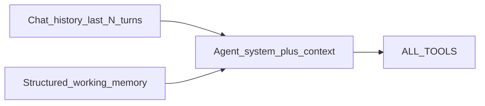

# Junior Implementation Guide — Short-Term Memory for Camp Agent

> **Audience:** Junior developer  
> **Goal:** When a user says *“create a task in it named syntax”* after creating a project, the agent must use that project — not ask “which project?”  
> **Do not** rebuild chat persistence. That is already done.  
> **Do not** edit this file’s intent; follow the design below unless a lead changes it.

---

## 0. Read this first (what is already done vs what is missing)

| Capability | Status | What it does |
|---|---|---|
| Chat persistence (reload UI) | **Done** | `AgentChat` + `AgentChatMessage` in Mongo; `/agent` reloads history |
| History forwarded to Groq | **Done** | Node sends last 20 turns as `history` to FastAPI |
| **Short-term / working memory** | **Missing** | Agent still fails pronoun references like “it” / “that project” |

### Bug to fix (acceptance test)

1. User (or agent) creates project **python learning** (agent even has the project `_id`).  
2. User: `can you create a task in it named as syntax`  
3. **Broken today:** agent asks which project.  
4. **Required:** agent creates task `syntax` in project `python learning` (using stored id/name).

Persistence alone is not enough: the model often ignores pronouns in long chat text, and the current system prompt tells it to **never invent ObjectIds** and to **list projects first**, which pushes it to ask again instead of reusing the id from the last turn.

---

## 1. Senior recommendation (optimal design)

Use **two layers**:



1. **Keep chat history** (already implemented) — narrative context.  
2. **Add structured short-term memory (STM)** on the user’s `AgentChat` — hard facts the model must prefer for “it / that / this project / that task”.

STM is small, typed, and updated from **successful tool results**, not by scraping assistant prose.

### Why not only “send more history”?

- Already sending history and the bug still happens.  
- Models are weak at pronoun resolution under tool-calling pressure.  
- Structured “current focus” beats hoping the LLM re-reads a long answer.

### Why not a vector DB / long-term memory product?

Overkill for v1. This product needs **session working memory** (last project/task), not semantic search across years of chat.

### Why not `langgraph.checkpoint.memory` / `MemorySaver` / `InMemorySaver`?

**Do not use in-memory LangGraph checkpointers for this product.**

| Option | Use? | Why |
|---|---|---|
| `MemorySaver` / `InMemorySaver` | **No** | Process-local only. Lost on FastAPI restart, useless with multiple workers, does not match Node-owned user threads. |
| Postgres checkpointer | Possible later | Extra infra; we already run Mongo. |
| **`MongoDBSaver` (`langgraph-checkpoint-mongodb`)** | **Yes, when LangGraph lands** | Durable short-term thread state in the same DB family as the app. |
| Structured `workingMemory` on `AgentChat` | **Yes, now** | Fixes “it / that project” immediately; same shape becomes LangGraph state later. |

Lead decision for multi-agent later:

1. **Short-term memory for LangGraph** = durable **checkpointer** (`MongoDBSaver`), with `thread_id` = Camp Agent chat / user thread id from Node.  
2. **Entity focus memory** (last project/task) = a **typed field in graph state** (`working_memory`), not only raw message replay.  
3. Until LangGraph is added, keep that same `working_memory` on Mongo `AgentChat` so migration is copy-shape, not redesign.

Checkpoints alone store conversation/graph channels. They do **not** replace structured STM for pronouns unless `working_memory` is part of state and updated by tool reducers/nodes.

---

## 2. Data model (Node)

Extend [`project_management/src/models/agentchat.models.js`](../project_management/src/models/agentchat.models.js).

Add a `workingMemory` object (embedded, not a new collection):

```js
workingMemory: {
  lastProject: {
    id: String,      // Mongo ObjectId string
    name: String,
  },
  lastTask: {
    id: String,
    title: String,
    projectId: String,
  },
  updatedAt: Date,
}
```

Rules:

- Optional fields; start empty.  
- Cleared when user hits **Reset Chat** (`DELETE /api/v1/agent/messages`) — clear messages **and** reset `workingMemory` to `{}`.  
- Never accept STM from the browser; only server updates it.

---

## 3. Runtime contract changes

### 3.1 Node → FastAPI (`POST /agent/run`)

Today Node sends:

```json
{ "query": "...", "history": [ ... ] }
```

Also send:

```json
{
  "query": "...",
  "history": [ ... ],
  "working_memory": {
    "last_project": { "id": "...", "name": "python learning" },
    "last_task": null
  }
}
```

Load `workingMemory` from `AgentChat` after `getOrCreateAgentChat`.

### 3.2 FastAPI request schema

Update [`user_agent/src/user_agent/api/schemas.py`](src/user_agent/api/schemas.py):

- Optional `working_memory` object (nullable fields ok).

### 3.3 FastAPI → Node response

Today:

```json
{ "ok": true, "answer": "...", "messages": [ ...tool trace... ] }
```

Also return (optional):

```json
{
  "ok": true,
  "answer": "...",
  "messages": [ ... ],
  "working_memory_patch": {
    "last_project": { "id": "...", "name": "..." },
    "last_task": { "id": "...", "title": "...", "project_id": "..." }
  }
}
```

Node merges the patch into `AgentChat.workingMemory` after a successful run (only non-null fields).

---

## 4. Where to update STM (important)

**Update STM in FastAPI from tool results**, then send a patch to Node.

Do **not** parse the English answer like “Created project python learning” with regex as the primary source. Prefer tool payload:

- After `create_project` / `get_project` / `list_projects` (if user clearly selected one) → set `last_project`
- After `create_task` / `get_task` / `update_task` → set `last_task` (and `last_project` from that task’s `project` if present)

Implementation sketch in [`runner.py`](src/user_agent/agents/runner.py):

1. Run agent as today with history.  
2. Walk the returned message list (tool calls + tool messages).  
3. When a tool result has `ok: true` and known shape, extract ids.  
4. Return `working_memory_patch` alongside `answer`.

If tool JSON is nested in `ToolMessage.content` as a stringified dict, `json.loads` carefully; ignore parse failures.

Node merge logic:

```text
if patch.last_project: chat.workingMemory.lastProject = patch.last_project
if patch.last_task: chat.workingMemory.lastTask = patch.last_task
chat.workingMemory.updatedAt = now
await chat.save()
```

---

## 5. Inject STM into the model (prompt)

In `run_agent(query, history=None, working_memory=None)`:

Build a short context message **after** history and **before** the current user query (or fold into system prompt). Example content:

```text
SHORT-TERM MEMORY (trusted server state; prefer this for pronouns like "it", "that project", "that task"):
- last_project: id=<id>, name=<name>
- last_task: id=<id>, title=<title>, project_id=<project_id>
If the user refers to "it" / "that" without a new name, use last_project / last_task.
Do not ask which project if last_project is set, unless the user names a different project.
ObjectIds from SHORT-TERM MEMORY and from prior tool results are allowed. Do not invent new ids.
```

### Fix the system prompt conflict

Current rule in `SYSTEM_PROMPT`:

> Never invent MongoDB ObjectIds. Resolve names with list_projects / list_tasks / get_* first.

Replace with clearer rules, e.g.:

1. Never invent ObjectIds that did not come from tools, history tool results, or SHORT-TERM MEMORY.  
2. If SHORT-TERM MEMORY has `last_project` and the user says “it/that project”, use that id.  
3. If the user names a **new** project name, resolve with tools (`list_projects` / create).  
4. Prefer tools over guessing when memory is empty.

Also bump `build_agent` carefully: if system prompt is baked into `@lru_cache` agent, either:

- stop caching the agent, or  
- keep static system prompt and inject STM as a separate message each invoke (preferred — cache stays valid).

**Preferred:** keep cached agent + static system prompt; inject STM as an extra `user` or `system` style message in the `messages` array each run.

---

## 6. Files to touch (checklist)

### Node (`project_management`)

- [ ] `src/models/agentchat.models.js` — add `workingMemory`  
- [ ] `src/controllers/agent.controllers.js`  
  - [ ] Send `working_memory` to FastAPI  
  - [ ] Merge `working_memory_patch` on success  
  - [ ] Clear STM on `clearAgentMessages`  
- [ ] No new public STM endpoints required for v1

### FastAPI (`user_agent`)

- [ ] `api/schemas.py` — `working_memory` in / `working_memory_patch` out (response schema)  
- [ ] `agents/runner.py` — inject STM message; extract patch from tool results; update system rules  
- [ ] `api/routes/agent.py` — pass working_memory into `run_agent`  
- [ ] Unit tests: history + STM injection; patch extraction from a fake tool result

### Frontend

- [ ] **No UI required** for v1 (STM is invisible server state)  
- [ ] Manual QA only on `/agent`

### Docs / context (after merge)

- [ ] Update `cursor_agent/context/PERSISTENT_AGENT_CHAT.md` or add `SHORT_TERM_MEMORY.md`  
- [ ] Mark related problem in `problems/problems.md` when verified

---

## 7. Implementation order

1. **Prompt + inject STM message with empty memory** — prove plumbing; may already improve “it” if history works.  
2. **Extend `AgentChat.workingMemory` + Node send/merge/clear.**  
3. **Extract `working_memory_patch` from tool results in `runner.py`.**  
4. **Tighten system prompt rules** (ids from memory are allowed).  
5. **Manual acceptance test** (section 8).  
6. **Unit tests** for runner injection + patch extraction.

---

## 8. Acceptance tests (must pass)

### A. Pronoun after create (the screenshot bug)

1. `Create a project called python learning`  
2. `can you create a task in it named as syntax`  
3. Expect: task created in that project; agent does **not** ask which project.

### B. Memory survives reload

1. After A, reload `/agent`.  
2. `list tasks in it` (or “in that project”).  
3. Expect: still uses `python learning` (STM restored from Mongo with the chat).

### C. Reset clears STM

1. Reset Chat.  
2. `create a task in it named x`  
3. Expect: agent asks for project (or lists projects) — memory empty.

### D. Explicit new name overrides memory

1. Memory has project A.  
2. `create a task named y in project B`  
3. Expect: task in B; STM `last_project` becomes B after success.

### E. Auth isolation

User 1’s STM must never apply to User 2 (chat is still keyed by `req.user._id`).

---

## 9. Out of scope (v1)

- Vector / embedding memory  
- Multiple named agent threads  
- Remembering arbitrary free-form facts (“user likes red”)  
- Frontend display of STM  
- Changing project-chat `Conversation` / `Message` models

---

## 10. Definition of done

- [ ] Acceptance tests A–E pass manually  
- [ ] Reset Chat clears messages **and** working memory  
- [ ] FastAPI unit tests cover STM injection + patch extraction  
- [ ] No client-supplied STM trust boundary violations  
- [ ] Lead/senior can re-run the screenshot scenario successfully

---

## 11. Hints / pitfalls

1. **`build_agent` is `@lru_cache`’d** — do not put per-user STM into the cached system prompt; inject per request.  
2. Tool results may be strings — parse JSON safely.  
3. Only update STM on **`ok: true`** tool results.  
4. History must still exclude the current query (Node already does this).  
5. If create_task needs `project_id`, STM `last_project.id` should be used as `project_id` tool arg.

---

## Summary for juniors

| Layer | Job |
|---|---|
| Mongo `AgentChat.workingMemory` | Store last project/task facts |
| Node proxy | Send STM in; merge patch out; clear on reset |
| FastAPI runner | Inject STM into messages; extract patch from tools; fix prompt rules |
| Frontend | Unchanged UI; QA the pronoun flow |

**Success = the screenshot scenario works without asking “which project?”.**
